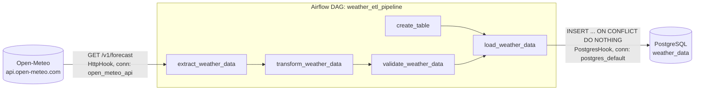

# ETLWeather

An Apache Airflow ETL pipeline, built on the Astronomer Astro CLI, that pulls the current weather for a location from the [Open-Meteo](https://open-meteo.com) API and stores each reading in PostgreSQL.

## What it does

The `weather_etl_pipeline` DAG runs `@daily`. Each run:

1. Creates the `weather_data` table if it doesn't exist.
2. Fetches current conditions for a latitude/longitude (default: London) from Open-Meteo.
3. Reshapes the response into a flat record.
4. Rejects implausible readings.
5. Inserts the record into Postgres, skipping duplicates.

No API key is needed. Open-Meteo's free tier is open for non-commercial use, so the `open_meteo_api` connection only holds the host URL.

## Architecture



| Task | Type | Role |
|------|------|------|
| `create_table` | `SQLExecuteQueryOperator` | Idempotent `CREATE TABLE IF NOT EXISTS weather_data` |
| `extract_weather_data` | TaskFlow `@task` + `HttpHook` | `GET /v1/forecast?current_weather=true` for the configured coordinates |
| `transform_weather_data` | TaskFlow `@task` | Flattens `current_weather` into one row (temperature, windspeed, winddirection, weathercode, observed_at) |
| `validate_weather_data` | TaskFlow `@task` | Raises `AirflowFailException` (no retry) if temperature is missing or outside -90..60 °C |
| `load_weather_data` | TaskFlow `@task` + `PostgresHook` | Parameterized insert; runs after both `create_table` and validation |

### Design notes

- **Connections, not hardcoded hosts.** The API and database are reached through Airflow connections (`open_meteo_api`, `postgres_default`), so credentials and URLs live outside the DAG code.
- **Idempotent loads.** `weather_data` has `UNIQUE (latitude, longitude, observed_at)` and the insert uses `ON CONFLICT DO NOTHING`, so re-runs within the same API reading don't create duplicates.
- **Fail fast on bad data.** Validation failures use `AirflowFailException`, so they skip the default 2 retries (5 min apart) that cover transient API errors.
- **Runtime parameters.** `latitude` and `longitude` are validated `Param`s (range-checked). Override them via *Trigger DAG w/ config* in the UI.
- **`catchup=False`.** The API returns current conditions only, so backfilling past dates would just store today's reading repeatedly.

### Table schema

```sql
weather_data (
    latitude FLOAT, longitude FLOAT,
    temperature FLOAT, windspeed FLOAT, winddirection FLOAT, weathercode INT,
    observed_at TIMESTAMP,                    -- time of the reading, from the API
    timestamp TIMESTAMP DEFAULT CURRENT_TIMESTAMP,  -- time of insertion
    UNIQUE (latitude, longitude, observed_at)
)
```

## Project layout

```
.
├── dags/etlweather.py          # the weather_etl_pipeline DAG
├── tests/dags/
│   ├── test_etlweather.py      # structure, transform, validation, load (mocked hooks)
│   └── test_dag_example.py     # generic DAG import/integrity checks
├── airflow_settings.yaml       # local-only connections (open_meteo_api, postgres_default)
├── Dockerfile                  # Astro Runtime 13.12.2
├── requirements.txt            # extra Python deps (none needed beyond the runtime)
├── packages.txt                # OS-level packages (none)
└── .astro/config.yaml          # Astro project config (Postgres exposed on 5433)
```

## Running locally

Prerequisites: Docker and the [Astro CLI](https://www.astronomer.io/docs/astro/cli/install-cli).

```bash
astro dev start
```

This starts the Airflow scheduler, webserver, triggerer and a Postgres container, and imports the connections from `airflow_settings.yaml`.

- Airflow UI: http://localhost:8080 (user `admin`, password `admin`)
- Postgres: `localhost:5433`, database `postgres`, user/password `postgres`

Then unpause `weather_etl_pipeline` and trigger it. Check the result:

```bash
psql -h localhost -p 5433 -U postgres -c "SELECT * FROM weather_data ORDER BY timestamp DESC LIMIT 5;"
```

### Different location

Use *Trigger DAG w/ config* and set, for example:

```json
{ "latitude": 40.7128, "longitude": -74.0060 }
```

## Testing

```bash
astro dev pytest tests/
```

The tests cover DAG structure and dependencies, parameter bounds, the transform, validation failures, and the load query. Hooks are mocked, so no network or database is needed.

## Deploying

The `airflow_settings.yaml` connections are for local development only. On Astro or another Airflow deployment, create the `open_meteo_api` (HTTP, host `https://api.open-meteo.com`) and `postgres_default` connections through the UI, environment variables or a secrets backend. See the [Astronomer deploy docs](https://www.astronomer.io/docs/astro/deploy-code/).

If you later use Open-Meteo commercially, buy a plan and send the key as an `apikey` query parameter against `customer-api.open-meteo.com`.

## License

See [LICENSE](LICENSE).
